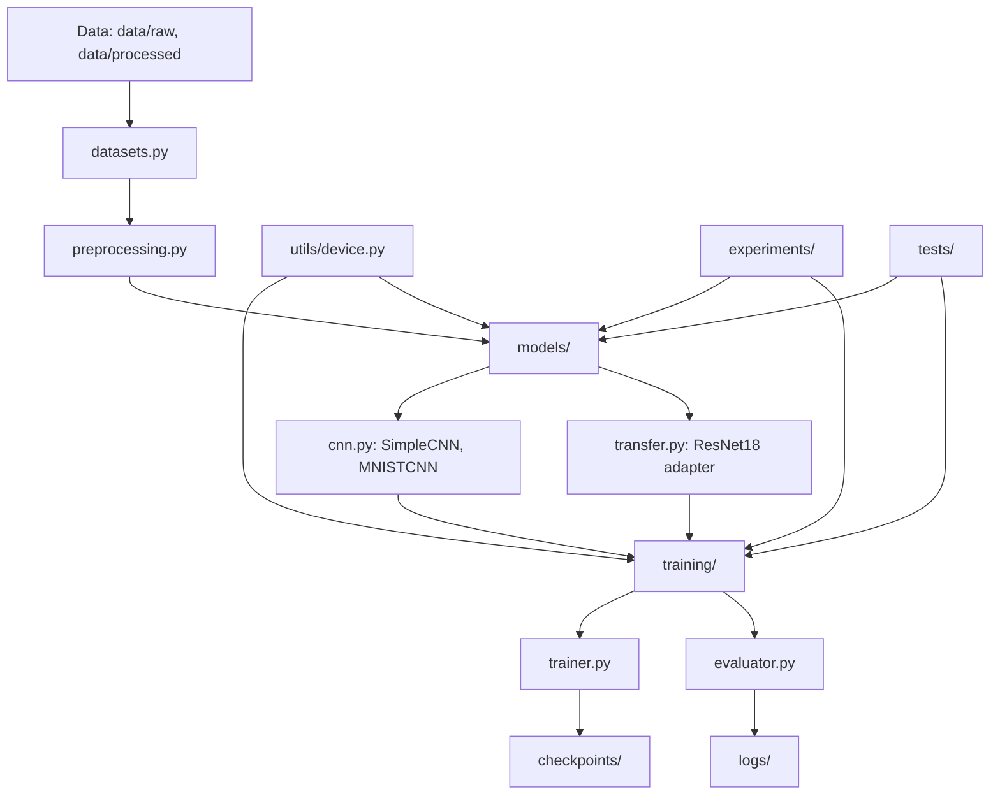

# Architecture

## Design Principles

- **Local-first and CPU-compatible**: No paid cloud GPUs required. Runs on CPU
  (Intel i7-1265U) with PyTorch `+cpu` builds.
- **Modular**: Separation of datasets, preprocessing, models, training, and
  evaluation into distinct modules under `src/`.
- **Reproducible**: Pinned dependencies in `requirements.txt`, fixed random
  seeds for data splitting, and explicit device selection.
- **Extensible**: New models, datasets, and training loops can be added
  without modifying existing code.

## Component Diagram

## Data Flow

### Week 9: Foundations & CNN

1. **Dataset loading** (`datasets.py`): Load MNIST/CIFAR-10/CIFAR-100 via
   torchvision, apply train/validation split.
2. **Preprocessing** (`preprocessing.py`): Normalize, augment (random crop,
   horizontal flip, random affine), denormalize for visualization.
3. **Model** (`models/cnn.py`): `SimpleCNN` (32x32 RGB) or `MNISTCNN`
   (28x28 grayscale) forward pass.
4. **Training** (`training/trainer.py`): Train/validate loop with loss and
   accuracy tracking, checkpoint saving/loading.
5. **Evaluation** (`training/evaluator.py`): Test accuracy, per-class metrics.

### Device Selection

`utils/device.py` selects CUDA if an NVIDIA GPU is available, otherwise CPU.
All tensors and models are moved to the selected device via `to_device()`.

## Directory Purpose

| Directory | Contents | Git-tracked |
|-----------|----------|-------------|
| `src/` | Source code (datasets, models, training, utils) | Yes |
| `experiments/` | Experiment scripts, notebooks | Yes |
| `tests/` | pytest test suite | Yes |
| `data/raw/` | Downloaded raw datasets | No |
| `data/processed/` | Preprocessed/ cached datasets | No |
| `checkpoints/` | Saved model weights (.pt, .pth) | No |
| `logs/` | Training logs, TensorBoard | No |
