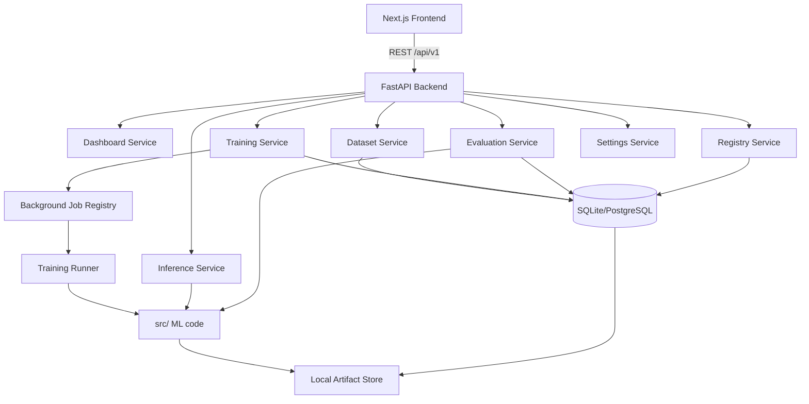

# DeepVision AI Studio — Full-Stack Architecture

## 1. Purpose

DeepVision AI Studio turns the existing CPU-first ML/DL/NLP codebase into a
single AI platform with eight pages: Dashboard, Datasets, Model Training,
Model Evaluation, AI Playground, NLP Playground, Model Registry, and Settings.

The architecture is local-first and free-first: CPU-only inference and
training, local artifact storage, and no cloud or GPU dependency.

## 2. Existing Reusable Components

| Domain | Existing code | Reuse in app |
|---|---|---|
| Datasets | `src/datasets.py`, `src/preprocessing.py` | CIFAR-10/MNIST loading, transforms, splits |
| Vision models | `src/models/cnn.py`, `src/models/cifar_cnn.py` | `MNISTCNN`, `CifarCNN` |
| Transfer learning | `src/models/transfer.py` | Pretrained ResNet18, freezing |
| Training | `src/training/trainer.py`, `scripts/train_*.py` | Loops, checkpoints, evaluation |
| Evaluation | `src/evaluation/metrics.py`, `src/training/evaluator.py` | Accuracy, P/R/F1, confusion matrix |
| NLP foundations | `src/nlp/tokenizer.py`, `vocabulary.py`, `embeddings.py` | Tokenization, embeddings |
| Transformer | `src/nlp/attention.py`, `transformer.py` | Self-attention encoder |
| HF inference | `src/nlp/huggingface.py`, `src/nlp/service.py` | Sentiment, embeddings, NER |
| Fine-tuning | `src/nlp/imdb.py`, `scripts/train_distilbert.py` | DistilBERT sentiment |
| Artifacts | `artifacts/*.pt`, `artifacts/*.json` | Read-only experiment records |

## 3. Proposed Stack

### Backend
- FastAPI + Uvicorn
- Pydantic v2 schemas
- SQLAlchemy + SQLite initially (PostgreSQL-ready via `DATABASE_URL`)
- PyTorch, Torchvision, Transformers
- Standard-library background worker (`ThreadPoolExecutor` + job registry)

### Frontend
- Next.js (App Router), React, TypeScript
- Tailwind CSS, shadcn/ui
- TanStack Query, React Hook Form, Zod
- lucide-react

### Infrastructure
- Docker + docker-compose
- Local artifact volume
- PostgreSQL only when multi-user persistence is justified

## 4. System Diagram



## 5. Layered Backend Layout

```
backend/
  app/
    main.py
    api/v1/            # routers per page
    core/              # config, logging, lifecycle
    db/                # SQLAlchemy models, session
    schemas/           # Pydantic request/response models
    services/          # dashboard, datasets, training, evaluation, inference, registry
    jobs/              # job registry, worker, cancellation
    ml/                # adapters importing src/ modules
  tests/
frontend/
  app/                 # 8 routes
  components/          # design-system components
  features/            # page-specific components and hooks
  lib/api/             # typed API client
  lib/schemas/         # Zod schemas
```

## 6. Artifact and Data Separation

- **Experiment artifacts (read-only):** existing `artifacts/*.pt` and
  `artifacts/*.json` produced before Milestone 5.
- **Application artifacts:** `artifacts/app/<run_id>/` for new checkpoints,
  logs, evaluation JSON, and metadata. Never overwritten.
- **Database:** metadata only; checkpoints remain files.
- **Datasets:** existing `data/raw/`; app-managed dataset metadata in DB.

## 7. Background Training Design

1. `POST /api/v1/training/jobs` validates config and creates a `QUEUED` job.
2. A `ThreadPoolExecutor(max_workers=1)` worker runs the training function.
3. Job states: `QUEUED → RUNNING → SUCCEEDED | FAILED | CANCELLED`.
4. Progress and logs are stored in memory and mirrored to
   `artifacts/app/<run_id>/training.log`.
5. Cancellation sets a cooperative `threading.Event`; the runner checks it
   between epochs and saves a resumable checkpoint.
6. CPU-only; one concurrent training job by default to protect latency.

## 8. Configuration and Environment

Key settings (`.env`):
```
DEEPVISION_DATABASE_URL=sqlite:///./deepvision.db
DEEPVISION_ARTIFACT_ROOT=artifacts
DEEPVISION_DATA_ROOT=data
DEEPVISION_MAX_TRAINING_WORKERS=1
DEEPVISION_CORS_ORIGINS=http://localhost:3000
DEEPVISION_DEVICE=cpu
```

## 9. Risks and Limitations

- CPU training is slow for ResNet/DistilBERT; default UI presets stay small.
- Single-process job registry is lost on backend restart; DB job records remain.
- Local artifact storage is single-node only.
- NER and sentiment models are English-only.
- No authentication in the initial local-first version.
