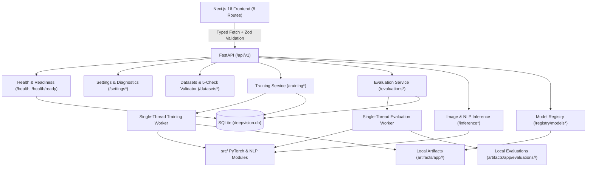

# DeepVision AI Studio — Full-Stack Architecture

## 1. Purpose

DeepVision AI Studio exposes the repository's CPU-first PyTorch vision and NLP codebase through a FastAPI backend ([src/api/](file:///d:/Developer/Projects/advanced-deep-learning/src/api)) and an eight-route Next.js App Router frontend ([frontend/](file:///d:/Developer/Projects/advanced-deep-learning/frontend)):

- **Dashboard (`/`)**
- **Datasets (`/datasets`)**
- **Model Training (`/training`)**
- **Model Evaluation (`/evaluation`)**
- **AI Playground (`/playground`)**
- **NLP Playground (`/nlp`)**
- **Model Registry (`/registry`)**
- **Settings (`/settings`)**

The system is local-first and CPU-compatible: all training, evaluation, and inference execute locally on CPU against local datasets and checkpoints without cloud dependencies.

---

## 2. Core ML & Backend Integration Map

| Domain | Core ML Module | FastAPI Adapter / Service |
| --- | --- | --- |
| Datasets | `src/datasets.py`, `src/preprocessing.py` | `src/api/services/datasets.py`, `src/api/routers/datasets.py` |
| Vision CNNs | `src/models/cnn.py`, `src/models/cifar_cnn.py` | `src/api/training/pipelines.py`, `src/api/evaluation/pipelines.py`, `src/api/inference/image.py` |
| Transfer Learning | `src/models/transfer.py` (`ResNet18`) | `src/api/training/pipelines.py`, `src/api/evaluation/pipelines.py`, `src/api/inference/image.py` |
| NLP Foundations & HF | `src/nlp/service.py`, `src/nlp/huggingface.py`, `src/nlp/imdb.py` | `src/api/inference/nlp.py`, `src/api/evaluation/pipelines.py` |
| Model Registry | `artifacts/*.pt`, `artifacts/*.json`, `artifacts/app/<job_id>/model.json` | `src/api/services/registry.py`, `src/api/routers/registry.py` |
| Health & Diagnostics | `src/api/config.py`, `src/api/db.py` | `src/api/services/health.py`, `src/api/services/settings.py` |

---

## 3. Implemented Stack

### Backend (`src/api/`)
- **FastAPI + Uvicorn** (`src/api/main.py`)
- **Pydantic v2** request/response schemas (`src/api/schemas*.py`)
- **SQLAlchemy 2.1 + SQLite** (`deepvision.db`, `src/api/db.py`) storing `training_job_records` (`TrainingJobRecord`) and `evaluation_records` (`EvaluationRecord`)
- **PyTorch `2.15.0+cpu`, Torchvision, Hugging Face Transformers**
- **Dedicated single-worker background queues** (`src/api/training/service.py`, `src/api/evaluation/service.py`) with cooperative `threading.Event` cancellation and line-indexed incremental logs

### Frontend (`frontend/`)
- **Next.js `16.4.6` (App Router, Turbopack)**, **React `19.3.0`**, **TypeScript 5**
- **Tailwind CSS 4**, **shadcn/ui** (`@base-ui/react` primitives), **Lucide Icons**
- **TanStack Query v5** (`frontend/src/lib/api/queries/*`, `frontend/src/lib/api/mutations/*`)
- **Zod v4** runtime response and request validation (`frontend/src/lib/api/types.ts`, `frontend/src/lib/api/endpoints.ts`)
- **React Hook Form** (`@hookform/resolvers/zod`) for form validation
- **Vitest + React Testing Library** (`frontend/src/lib/__tests__/*`, `frontend/src/components/*/__tests__/*`, `frontend/src/app/__tests__/*`)

---

## 4. System Data Flow



---

## 5. Actual Directory Layout

```text
src/api/
  main.py                  # FastAPI lifespan, CORS, router mounting
  config.py                # Frozen Settings dataclass (env-driven)
  db.py                    # SQLAlchemy engine, SessionLocal, TrainingJobRecord, EvaluationRecord
  errors.py                # APIError exception and structured JSON error handlers
  schemas.py               # Health, Readiness, Settings, Registry, Error schemas
  schemas_datasets.py      # DatasetSummary, DatasetStatistics, ValidationResponse
  schemas_training.py      # TrainingConfig, TrainingPreset, TrainingJobResponse, TrainingLogsResponse
  schemas_evaluation.py    # EvaluationConfig, EvaluationResponse, EvaluationResultsResponse
  schemas_inference.py     # Image & NLP inference request/response schemas
  routers/                 # health.py, settings.py, datasets.py, registry.py, training.py, evaluations.py, inference.py
  services/                # artifacts.py, datasets.py, health.py, registry.py, settings.py
  training/                # catalog.py, pipelines.py, service.py
  evaluation/              # catalog.py, metrics.py, pipelines.py, service.py
  inference/               # image.py, nlp.py

frontend/src/
  app/
    layout.tsx             # Root dark layout, Geist fonts, Providers, AppShell
    page.tsx               # Dashboard (/)
    datasets/page.tsx      # Datasets (/datasets)
    training/page.tsx      # Model Training (/training)
    evaluation/page.tsx    # Model Evaluation (/evaluation)
    playground/page.tsx    # AI Playground (/playground)
    nlp/page.tsx           # NLP Playground (/nlp)
    registry/page.tsx      # Model Registry (/registry)
    settings/page.tsx      # Settings (/settings)
  components/
    layout/app-shell.tsx   # Responsive sidebar + mobile drawer + header
    providers.tsx          # QueryClientProvider, TooltipProvider, Sonner Toaster
    ui/                    # Shared dark-styled UI primitives
    datasets/              # Datasets workspace components & tests
    training/              # Training workspace components & tests
    evaluation/            # Evaluation workspace components & tests
    playground/            # AI Playground components & tests
    nlp/                   # NLP Playground components & tests
    registry/              # Model Registry components & tests
    settings/              # Settings workspace components & tests
  lib/
    api/
      client.ts            # API_BASE, api<T>() wrapper, structured ApiError
      types.ts             # Zod schemas and inferred TypeScript types
      endpoints.ts         # Zod-validated endpoint functions
      query-keys.ts        # Canonical TanStack Query key factories
      queries/             # useDatasets, useTraining*, useEvaluation*, useImageModels, useNlpModels, useRegistry*, useHealth/useReadiness/useSettings
      mutations/           # useValidateDataset, training/evaluation create & cancel, image & NLP inference mutations
    dashboard.ts           # Progress normalization (0..1 -> 0..100%) and readiness state derivation
    datasets.ts            # Dataset summaries, filtering, formatting, workspace links
    training.ts            # Job state helpers, form validation, API error formatting
    evaluation.ts          # Metric/byte formatters, evaluation filtering, comparison helpers
    inference.ts           # Image upload validation (5 MB, PNG/JPEG/WebP), Top-K formatting
    nlp.ts                 # Batch text parsing, L2 norm, zero-safe pairwise cosine similarity
    registry.ts            # Catalog vs trained-job source classification, filtering, related evaluations
    settings.ts            # Clamped memory/disk usage, readiness probes, SSR-safe localStorage preferences
```

---

## 6. Frontend API Layer & Validation Architecture

1. **HTTP Client (`client.ts`)**: Sends requests to `API_BASE` (`process.env.NEXT_PUBLIC_API_URL || "http://localhost:8000/api/v1"`), automatically sets `Content-Type: application/json` except for `FormData` uploads, and throws `ApiError` preserving HTTP `status`, backend `error.code`, `error.details`, parsed `detail` payload, and `isNetworkError`.
2. **Zod Contract Enforcement (`types.ts` & `endpoints.ts`)**: Every response from the backend is parsed through a Zod schema before reaching React components.
   - `getReadiness()` explicitly inspects `ApiError` with `status === 503` and parses `error.detail` via `ReadinessResponseSchema` so degraded readiness checks surface individual probe statuses (`database`, `artifact_root`, `artifact_root_writable`) instead of generic network errors.
3. **Shared Query Keys (`query-keys.ts`)**: All 8 routes share `queryKeys.{training,datasets,registry,evaluations,inference,system}` so mutations and cross-page navigation reuse and invalidate a single cache cleanly.

---

## 7. Artifact, Database & Inference Lifecycle

- **Read-Only Pretrained Artifacts**: `artifacts/*.pt` and `artifacts/*.json` are never overwritten by application runs.Path traversal is prevented by `resolve_allowed_path()` in `src/api/services/artifacts.py`, which restricts file access to `artifact_root`, `data_root`, and `config_root`.
- **Isolated Run Artifacts**:
  - Training jobs write to `artifacts/app/<job_id>/` (`config.json`, `training.log`, `job.json`, `checkpoint_partial.pt` → `checkpoint.pt`, `history.json`, `metrics.json`, `model.json`, or `error.json`).
  - Evaluations write to `artifacts/app/evaluations/<evaluation_id>/` (`config.json`, `evaluation.log`, `evaluation.json`, `metrics.json`, `results.json`, or `error.json`).
- **Database Persistence (`deepvision.db`)**: Only metadata and latest metrics are stored in SQLite (`training_job_records` and `evaluation_records`). On server startup, any job left in `RUNNING` state from a prior process crash is transitioned to `FAILED` with `RESTART_INTERRUPTED`, while `QUEUED` jobs are re-enqueued.
- **Lazy Thread-Safe Inference**:
  - `src/api/inference/image.py` lazily loads and caches PyTorch checkpoints per `model_id` under a thread lock, invalidating the cache if the checkpoint file's mtime/size fingerprint changes.
  - `src/nlp/service.py` (`NLPService`) lazily loads and caches tokenizers/models under a re-entrant lock with `local_files_only=True`.

---

## 8. Configuration & Operational Limitations

### Environment Variables (`src/api/config.py`)
```env
DEEPVISION_DATABASE_URL=sqlite:///./deepvision.db
DEEPVISION_ARTIFACT_ROOT=artifacts
DEEPVISION_DATA_ROOT=data
DEEPVISION_CONFIG_ROOT=configs
DEEPVISION_CORS_ORIGINS=http://localhost:3000
```
Frontend (`frontend/.env.local`):
```env
NEXT_PUBLIC_API_URL=http://localhost:8000/api/v1
```

### Operational Limitations
- **Single-Node Local Execution**: Designed for local CPU execution; one training worker and one evaluation worker run jobs sequentially (`max_queue = 4` pending jobs each).
- **Read-Only Configuration, Datasets & Registry**: Changing backend environment variables requires restarting FastAPI. No browser upload/import/delete endpoints exist for datasets or registry checkpoints.
- **Offline-Safe by Default**: Runtime endpoints never trigger background dataset or Hugging Face model downloads.
- **No Authentication or Container Packaging Shipped**: The application runs as a local single-user developer studio without auth or Docker files in the repository.
