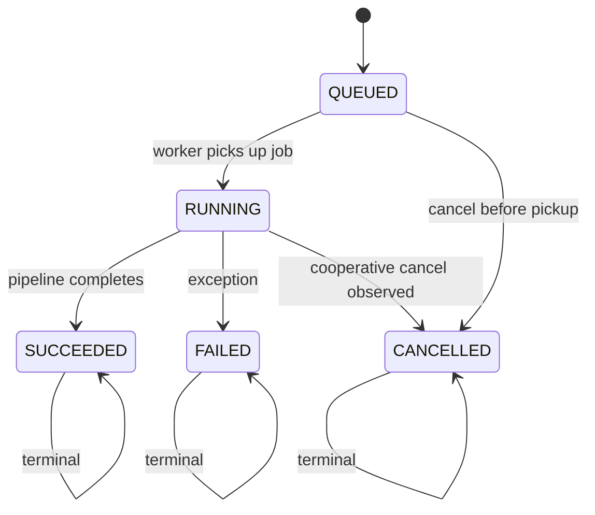

# Task 7D — Model Training Workspace Inspection

Date: 2026-11-20
Scope: read-only inspection of the training API, training job runtime, existing
frontend API layer, and UI architecture. No backend or frontend behavior was
changed.

## 1. Verified backend API contract

All routes are mounted under `/api/v1` in `src/api/main.py`.

| Method | Path | Success | Input | Response |
|---|---|---|---|---|
| GET | `/training/presets` | 200 | none | `{ "models": TrainingPreset[] }` |
| POST | `/training/jobs` | 201 | `CreateTrainingJobRequest` | `TrainingJobResponse` |
| GET | `/training/jobs` | 200 | `limit` optional, default 50, 1–200 | `{ "jobs": TrainingJobResponse[], "count": number }` |
| GET | `/training/jobs/{job_id}` | 200 | none | `TrainingJobResponse` |
| POST | `/training/jobs/{job_id}/cancel` | 200 | no body | `TrainingJobResponse` |
| GET | `/training/jobs/{job_id}/logs` | 200 | `since` ≥ 0 default 0; `limit` 1–2000 default 500 | `TrainingLogsResponse` |

Important route details:

- `GET /training/jobs` always sorts by `created_at` descending. It has no state
  filter even though the service internally supports one.
- Log `since` is a zero-based line index, not a timestamp or line number.
- `POST /training/jobs` returns 201 and may already show `RUNNING`, because the
  worker can start before the response is serialized.
- There is no endpoint for per-epoch history, artifact download, queue capacity,
  active-job summary, or training metrics beyond the current job payload.

### Exact response schemas

`TrainingPreset`:

```json
{
  "model": "cifar_cnn",
  "dataset": "cifar10",
  "display_name": "CIFAR-10 Custom CNN",
  "architecture": "CifarCNN",
  "default_config": {
    "epochs": 5,
    "batch_size": 128,
    "learning_rate": 0.001,
    "weight_decay": 0.0005,
    "val_fraction": 0.1,
    "seed": 42,
    "num_workers": 0,
    "image_size": 32
  }
}
```

`TrainingJobResponse` fields:

```text
job_id, model, dataset, state,
current_epoch, total_epochs, current_batch, total_batches, progress,
metrics: { train_loss, train_acc, val_loss, val_acc } (each nullable),
created_at, started_at, completed_at, elapsed_seconds,
cancel_requested, queue_position, device,
artifact_dir, checkpoint_path, history_path, metrics_path,
metadata_path, config_path,
error: { code, message } | null
```

`TrainingLogsResponse` fields:

```text
job_id, lines: string[], since, next_since, total_lines, complete
```

### Actual presets returned locally

The endpoint returned the following four presets from
`src/api/training/catalog.py` and the preset JSON files:

| Model ID | Display name | Dataset | Defaults |
|---|---|---|---|
| `cifar_cnn` | CIFAR-10 Custom CNN | `cifar10` | epochs 5, batch 128, lr 0.001, weight decay 0.0005, val 0.1, seed 42, workers 0, image 32 |
| `resnet18_feature_extraction` | ResNet18 Feature Extraction | `cifar10` | epochs 2, batch 32, lr 0.001, weight decay 0.0005, val 0.1, seed 42, workers 0, image 128 |
| `resnet18_finetuning` | ResNet18 Fine-tuning | `cifar10` | epochs 1, batch 64, lr 0.0001, weight decay 0.0005, val 0.1, seed 42, workers 2, image 128 |
| `mnist_cnn` | MNIST CNN | `mnist` | epochs 1, batch 64, lr 0.001, weight decay 0.0005, val 0.1, seed 42, workers 0, image 28 |

## 2. Request and response examples from the actual schemas

### Create request

```json
{
  "model": "mnist_cnn",
  "dataset": "mnist",
  "config": {
    "epochs": 1,
    "batch_size": 64,
    "learning_rate": 0.001,
    "weight_decay": 0.0005,
    "val_fraction": 0.1,
    "seed": 42,
    "num_workers": 0,
    "image_size": 28
  }
}
```

Only `model`, `dataset`, and `config` are request fields. `config` may be
omitted or contain only overrides. Missing config values are resolved from the
model preset and global defaults.

### Create response / job status response

The field set below is exact. The values are illustrative except where noted.

```json
{
  "job_id": "job_0123456789abcdef",
  "model": "mnist_cnn",
  "dataset": "mnist",
  "state": "RUNNING",
  "current_epoch": 1,
  "total_epochs": 1,
  "current_batch": 400,
  "total_batches": 844,
  "progress": 0.474,
  "metrics": {
    "train_loss": null,
    "train_acc": null,
    "val_loss": null,
    "val_acc": null
  },
  "created_at": "2026-11-20T05:00:00Z",
  "started_at": "2026-11-20T05:00:01Z",
  "completed_at": null,
  "elapsed_seconds": 18.2,
  "cancel_requested": false,
  "queue_position": null,
  "device": null,
  "artifact_dir": "<artifact_root>/app/job_0123456789abcdef",
  "checkpoint_path": "<artifact_root>/app/job_0123456789abcdef/checkpoint.pt",
  "history_path": "<artifact_root>/app/job_0123456789abcdef/history.json",
  "metrics_path": "<artifact_root>/app/job_0123456789abcdef/metrics.json",
  "metadata_path": "<artifact_root>/app/job_0123456789abcdef/job.json",
  "config_path": "<artifact_root>/app/job_0123456789abcdef/config.json",
  "error": null
}
```

Notes:

- `device` is populated only after successful completion. It is normally `null`
  while queued or running.
- The checkpoint path is assigned before training starts, but the file is not
  guaranteed to exist until the job succeeds.
- `metrics` becomes non-null after an epoch completes. It contains the latest
  epoch values, not a full history and not the file's `best_val_accuracy`.
- `queue_position` is present only for jobs remaining in the in-memory pending
  queue.
- Artifact paths are local filesystem paths. No download/open API exists.

### Incremental logs response

```json
{
  "job_id": "job_0123456789abcdef",
  "lines": [
    "[2026-11-20T05:00:00+00:00] job created model=mnist_cnn dataset=mnist",
    "[2026-11-20T05:00:01+00:00] job started device=cpu",
    "[2026-11-20T05:00:01+00:00] epoch 1/1 started"
  ],
  "since": 0,
  "next_since": 3,
  "total_lines": 3,
  "complete": false
}
```

When a terminal job has returned all lines, `complete` is true. The frontend
should append lines using `next_since` and stop polling once complete.

## 3. Supported models, datasets, and configuration

### Models and compatibility

| Canonical model | Aliases accepted by backend | Architecture | Pipeline | Dataset |
|---|---|---|---|---|
| `cifar_cnn` | `cifar10_custom_cnn`, `cifar10_custom_cnn_baseline`, `cifar10_cnn` | `CifarCNN` | CIFAR CNN | `cifar10` |
| `resnet18_feature_extraction` | `resnet18_feature_extractor` | `ResNet18` | frozen backbone | `cifar10` |
| `resnet18_finetuning` | `resnet18_finetuned`, `resnet18_fine_tuning` | `ResNet18` | layer4 + FC trainable | `cifar10` |
| `mnist_cnn` | none | `MNISTCNN` | MNIST CNN | `mnist` |

The API normalizes aliases to canonical model IDs in responses. The presets
endpoint exposes only canonical IDs, so the frontend should use those.

### Training config fields

| Field | Backend constraint | Default |
|---|---|---|
| `epochs` | integer 1–20 | 1 |
| `batch_size` | integer 1–512 | 32 |
| `learning_rate` | > 0 | 0.001 |
| `weight_decay` | ≥ 0 | 0.0005 |
| `val_fraction` | > 0 and < 0.5 | 0.1 |
| `seed` | integer, any | 42 |
| `num_workers` | integer 0–8 | 0 |
| `image_size` | integer 28–224 | 128 |

Additional config behavior:

- `cifar_cnn` requires `image_size=32`; any other supplied value returns 422.
- `mnist_cnn` requires `image_size=28`; any other supplied value returns 422.
- The ResNet presets use image size 128.
- Unknown config keys are silently ignored by Pydantic validation and do not
  affect training. The UI should submit only the eight supported fields.
- `scheduler` and `num_threads` are referenced by pipeline code or preset JSON,
  but are not part of `TrainingConfig`; they cannot be supplied through the API
  and are discarded from preset resolution. The cosine scheduler branch is
  currently unreachable through this API.
- Dataset availability is rechecked by the backend. An unavailable local dataset
  returns 409 `DATASET_UNAVAILABLE`.
- ResNet18 requests use torchvision pretrained weights. If those weights are not
  cached, torchvision may attempt a network download even though datasets use
  `download=False`. This is an existing local/free-first risk.

## 4. Job lifecycle, queueing, and limitations

### State machine



Terminal states: `SUCCEEDED`, `FAILED`, `CANCELLED`.

### Queue behavior

- One daemon worker thread executes at most one training job at a time.
- The pending queue default capacity is 4 jobs.
- A fifth pending job is rejected with 409 `QUEUE_FULL`, details
  `{ "max_queue": 4 }`.
- Capacity applies to pending jobs only; one running job may exist alongside up
  to four pending jobs.
- `queue_position` is 1-based. It moves as jobs are picked up or cancelled.
- No API reports queue capacity, active job ID, or global queue totals.

### Progress and metrics

- `progress` starts at 0 and is a fraction of all epochs.
- During epoch `e` of `n`, batch progress is approximately
  `((e - 1) + batch / total_batches) / n`.
- An epoch end sets progress to `epoch / total_epochs`.
- The completed success state sets progress to 1.
- Cancelled/failed progress can remain below 1.
- `current_batch` and `total_batches` refer to the latest training or validation
  loader callback. Validation also reports into these fields.
- Progress is persisted at most roughly every 0.5 seconds while batches run.
- Metrics are updated at epoch end and exposed only as latest
  `train_loss`, `train_acc`, `val_loss`, `val_acc`.
- Best validation accuracy is written into `metrics.json` but is not returned by
  the job API.

### Cancellation

- Cancelling a terminal job returns 409 with code `CANCELLED`.
- Cancelling a queued job removes it and finalizes it immediately.
- Cancelling a running job sets a cooperative cancellation event. Training and
  validation check it after each batch.
- A job may finish successfully if it completes before the next cancellation
  check.
- GPU is not required; the existing worker is CPU-compatible.

### Persistence and restart behavior

- Job metadata is persisted in SQLite table `training_job_records` via
  `TrainingJobRecord`.
- On backend startup:
  - Previously `RUNNING` jobs are marked `FAILED` with code
    `RESTART_INTERRUPTED`; they are not resumed.
  - Previously `QUEUED` jobs are re-enqueued and can run.
- In-memory live progress and log buffers are lost on restart. Logs fall back to
  each job's `training.log` file.
- Artifacts and terminal records survive restarts.
- There is no deletion, retention, or archive endpoint.

### Error handling

Backend errors use:

```json
{
  "error": {
    "code": "VALIDATION_ERROR",
    "message": "...",
    "details": {}
  }
}
```

Relevant cases:

| Code | HTTP | Cause |
|---|---|---|
| `NOT_FOUND` | 404 | Unsupported model or unknown job |
| `VALIDATION_ERROR` | 422 | Invalid config, incompatible dataset, fixed image-size mismatch |
| `DATASET_UNAVAILABLE` | 409 | Required local dataset assets are missing |
| `QUEUE_FULL` | 409 | Four pending jobs already exist |
| `CANCELLED` | 409 | Cancel requested for a terminal job |
| `CONFLICT` | 409 | Artifact directory collision |
| `INVALID_PATH` | 400 | Artifact path escapes the job root |
| `TRAINING_FAILED` | job error | Pipeline/runtime failure recorded on the job |

Note: `docs/api-contracts.md` says unsupported model/incompatible dataset errors
are 400. The implementation actually uses 404 for an unsupported model and 422
for incompatible dataset/config.

### Artifacts

Each job uses `<artifact_root>/app/<job_id>/`.

| File | Written | Content |
|---|---|---|
| `config.json` | at creation | Resolved training config |
| `training.log` | continuously | Timestamped log lines |
| `job.json` | snapshots | Latest job state metadata |
| `checkpoint_partial.pt` | during training | Best-so-far checkpoint |
| `checkpoint.pt` | on success | Final checkpoint moved from partial file |
| `history.json` | terminal | Epoch metrics list |
| `metrics.json` | terminal | Final metrics / cancellation / failure data |
| `error.json` | failure | Training failure details |
| `model.json` | success | Registry entry used by registry job discovery |

Successfully trained jobs are discoverable through
`GET /api/v1/registry/models` via `model.json`.

### Backend test coverage observed

`tests/test_api_training.py` covers:

- job creation with a fake pipeline
- unsupported model, incompatible dataset, invalid hyperparameters
- list/get/missing job
- successful progress and logs
- presets
- cancel rejection for a terminal job
- response field presence

Not covered by backend tests:

- queue-full rejection
- cancellation of a queued job
- cooperative cancellation of a running job
- restart recovery of queued vs interrupted running jobs
- unavailable dataset rejection
- artifact contents and registry discovery from a completed job
- real PyTorch training through the API

Task 7D should not assume those uncovered paths work differently from the source
review above, and frontend tests for those states must use controlled fixtures.

## 5. Existing frontend integration and missing pieces

### Already present

`frontend/lib/api/types.ts` already has Zod schemas and inferred types for:

- `TrainingConfig`
- `CreateTrainingJobRequest`
- `TrainingJob` and `TrainingJobList`
- `TrainingLogs`
- `TrainingPreset` and `TrainingPresetList`
- generic job error records

`frontend/lib/api/endpoints.ts` already has typed functions for all six training
routes:

- `getTrainingPresets`
- `listTrainingJobs`
- `createTrainingJob`
- `getTrainingJob`
- `cancelTrainingJob`
- `getTrainingLogs`

`frontend/lib/api/query-keys.ts` already defines:

- `training.all`
- `training.presets()`
- `training.jobs(limit)`
- `training.job(jobId)`
- `training.logs(jobId, since)`

### Missing

- `frontend/lib/api/queries/training.ts` does not exist. There are no
  `useTrainingPresets`, `useTrainingJobs`, or `useTrainingJob` hooks.
- `frontend/lib/api/mutations/training.ts` does not exist. Creation and
  cancellation mutations are missing.
- No incremental log accumulation hook exists. A plain React Query hook keyed by
  `since` would create fragmented cache entries unless it explicitly accumulates
  lines and advances `next_since`.
- No polling configuration exists for live jobs or logs.
- `TrainingJob.state` is typed as `string` rather than a closed
  `QUEUED | RUNNING | SUCCEEDED | FAILED | CANCELLED` union.
- Training metrics are a generic `Record<string, number | null>` rather than the
  four known keys.
- `job.error` is a generic string record rather than a typed
  `{ code, message } | null` shape.
- No training-specific pure helpers exist for status labels, filtering,
  summary counts, or progress formatting.

### Existing UI building blocks

Reusable:

- `PageHeader`, `SectionHeader`, `StatCard`
- `LoadingState`, `ErrorState`, `EmptyState`, `OfflineState`
- `Card`, `Button`, `Badge`, `Input`, `Label`, `Progress`, `Alert`
- `Dialog`, `Sheet`, `Tabs`, `Table`, `Skeleton`
- `Tooltip`, `Separator`
- `useDatasets` for dataset availability
- Native form controls and existing Tailwind design tokens

Not currently available:

- No custom `DataTable` abstraction.
- No shadcn `Form` wrapper; use `Label`/`Input` with React Hook Form.
- No chart library such as Recharts and no existing metric chart component.
- `sonner` is installed and a wrapper exists, but no `Toaster` is mounted in
  `app/layout.tsx`; use inline `Alert`/state feedback instead of toasts.
- `/training` is still a `RoutePlaceholder`.

The design system specifies a three-step model/dataset/config form, live
progress, log stream, cancellation, and checkpoint location, while preserving
the existing responsive shell and eight routes.

## 6. Recommended component architecture

Keep `/training` as a single client-rendered workspace. Do not add child routes.

```text
app/(studio)/training/page.tsx
  -> TrainingView

components/training/
  training-view.tsx              orchestration, selected job state, queries
  training-summary.tsx           backend-derived recent-job summary cards
  training-job-catalog.tsx       responsive table/cards + status filters
  training-job-status-badge.tsx  status/terminal semantics
  training-job-detail-sheet.tsx  job detail, progress, metrics, logs, cancel
  training-job-progress.tsx      progress bar and epoch/batch text
  training-job-metrics.tsx       latest reported metrics only
  training-job-logs.tsx          incremental appended log viewer
  training-run-dialog.tsx        three-step create form
  training-config-fields.tsx     numeric config inputs and inline errors
  cancel-training-dialog.tsx     confirmation for destructive cancel
```

Supporting modules:

```text
lib/api/queries/training.ts
  useTrainingPresets()
  useTrainingJobs({ limit })
  useTrainingJob(jobId)
  useTrainingJobLogs(jobId)  // accumulate lines and next_since

lib/api/mutations/training.ts
  useCreateTrainingJob()
  useCancelTrainingJob()

lib/training.ts
  status labels/order
  recent-job summary aggregation
  client-side status filtering
  progress/metric formatting
  preset lookup and config initial values
```

### Workspace layout

1. `PageHeader` with “New training run” and “Refresh”.
2. Summary cards derived from the loaded job list, explicitly scoped to the
   loaded recent jobs because the API has no global aggregate.
3. Active queue panel or highlighted active rows.
4. Responsive job catalog:
   - desktop table
   - mobile cards
   - status filter applied client-side
   - newest first, matching backend ordering
5. Create-run dialog with three steps:
   - model/preset
   - dataset and config
   - review and start
6. Detail sheet with tabs:
   - Overview: state, progress, latest metrics, resolved config, artifacts
   - Logs: incremental lines and complete state
7. Destructive cancel confirmation.

### Query and mutation strategy

- Presets: stale for the browser session; no automatic retry.
- Job list: poll every 3–5 seconds only while `QUEUED` or `RUNNING` jobs exist.
- Selected job: poll every 1.5–2.5 seconds while non-terminal.
- Logs: accumulate from `next_since`; stop when `complete` or terminal.
- Create mutation:
  - send only the canonical model ID, dataset, and supported config fields
  - disable while pending
  - invalidate `queryKeys.training.all`
  - select the returned job and open its detail sheet
- Cancel mutation:
  - disable while pending
  - invalidate the job list/detail
  - show inline success/error feedback

### UI correctness rules

- Never invent queue capacity, best accuracy, or epoch history.
- Label `val_acc` as the latest reported validation accuracy, not “best”.
- Do not plot a full epoch-history chart because no API provides that series.
  Latest metrics plus progress are the reliable live view.
- Do not turn artifact paths into download links. Display/copy paths only.
- Show `Not reported` for null metrics and unset timestamps.
- Show the backend status string and preserve terminal-state distinctions.
- Default the form from the selected preset; enforce fixed `image_size` for
  `cifar_cnn` and `mnist_cnn`.
- Check dataset availability through `useDatasets`; still rely on the backend as
  the final authority.
- Treat 409 `QUEUE_FULL`, 409 `DATASET_UNAVAILABLE`, and 422 config errors as
  actionable inline form errors.

## 7. Implementation sequence for Task 7D

1. Tighten training API contracts:
   - typed job-state union
   - typed metric keys
   - typed job error
   - keep request/response Zod parsing strict.
2. Add `lib/api/queries/training.ts` and
   `lib/api/mutations/training.ts`.
3. Add `lib/training.ts` helpers and unit tests.
4. Build the three-step run dialog with React Hook Form + Zod:
   - preset selection and defaults
   - config validation and fixed image size
   - dataset availability warning
   - review and create
5. Replace the training placeholder with `TrainingView`.
6. Build summary cards and responsive job catalog with client-side status
   filtering and all loading/error/empty/no-results states.
7. Build the job detail sheet:
   - progress and lifecycle
   - latest metrics
   - incremental logs
   - artifact/config display
   - cancellation flow.
8. Add polling rules and ensure polling stops for terminal jobs and completed
   logs.
9. Add responsive/accessibility polish consistent with Tasks 7B–7C.
10. Add tests and update frontend documentation.

## 8. Testing and verification plan

### Unit tests

- Zod parsing for create request, presets, jobs, logs, and error shapes.
- Summary aggregation and client-side status filtering.
- Progress/percent, duration, and null metrics formatting.
- Preset lookup and default-config cloning.
- Fixed image size behavior.
- Log accumulation advances `next_since` exactly once and stops at `complete`.

### Component tests with mocked hooks

- Presets loading, error, and empty state.
- Form step navigation, validation errors, pending submission, create success,
  API error, queue-full, and unavailable-dataset messages.
- Jobs loading, error, empty, and no-filter-results states.
- All five job states and their badges/actions.
- Progress text and metric rendering without fabricated values.
- Detail sheet opens for queued, running, succeeded, failed, and cancelled jobs.
- Logs incremental rendering, empty logs, error, and completion.
- Cancel confirmation, pending disable, success, and API error.
- Keyboard and accessible names for form, table/cards, tabs, log controls, and
  destructive action.

### Verification commands

```powershell
cd frontend
npm run typecheck
npm run lint
npm test
npm run build
```

From the repository root:

```powershell
.venv\Scripts\python.exe -m pytest -q
```

### Runtime/visual verification

- Desktop 1440 px, tablet 900 px, mobile 390 px.
- No horizontal overflow.
- New-run dialog and job detail sheet remain usable at mobile width.
- Polling updates a mock/running job without duplicate log lines.
- No console errors.
- Live API read checks:
  - presets load
  - jobs list loads
  - an invalid create request surfaces the correct backend error.
- Avoid starting a real CPU training run during routine UI verification unless
  explicitly desired; use deterministic intercepted job fixtures for lifecycle
  states. If an end-to-end real run is required, use a single-epoch MNIST job
  and account for local CPU time.

## 9. Risks and discrepancies to resolve carefully

1. `docs/api-contracts.md` is stale in several places:
   - says unsupported model/incompatible dataset use 400; implementation uses
     404/422
   - names the SQLite table `training_jobs`; implementation uses
     `training_job_records`
   - lists `best.pt` and `metadata.json`; implementation uses `checkpoint.pt`
     and `job.json`
   - says queued jobs are not resumed after restart; implementation re-enqueues
     queued jobs and only fails interrupted running jobs
2. No structured epoch-history API exists. Do not create charts that imply
   historical metrics are available.
3. `val_acc` in the job payload is the latest epoch value. Best validation
   accuracy exists only inside the artifact file.
4. `device` stays null until success.
5. Checkpoint and artifact paths are assigned before files exist.
6. Polling a running job is the only live-progress mechanism; there is no
   WebSocket/SSE stream.
7. `GET /training/jobs` is capped at 200 records and cannot filter by state on
   the server.
8. Queue full state is only discoverable from the create error.
9. Running cancellation is cooperative and can be delayed by a slow batch.
10. ResNet18 may require cached torchvision pretrained weights; this can violate
    a strictly offline expectation if the cache is empty.
11. Unknown config keys are silently ignored, so invalid frontend field names
    could appear accepted while having no effect. The UI must send only the
    documented fields.

## Files inspected

Backend and configuration:

- `src/api/routers/training.py`
- `src/api/schemas_training.py`
- `src/api/training/catalog.py`
- `src/api/training/pipelines.py`
- `src/api/training/service.py`
- `src/api/db.py` (training and evaluation record models)
- `src/api/config.py`
- `src/api/main.py`
- `src/api/errors.py`
- `src/api/routers/registry.py`
- `src/api/services/registry.py`
- `src/training/trainer.py`
- `src/models/transfer.py`
- `tests/test_api_training.py`
- `configs/cifar10_5epoch.json`
- `configs/resnet18_feature_extraction.json`
- `configs/resnet18_finetuning_optimized.json`
- `configs/mnist_cpu.json`

Frontend and design:

- `frontend/app/(studio)/training/page.tsx`
- `frontend/app/layout.tsx`
- `frontend/lib/api/types.ts`
- `frontend/lib/api/endpoints.ts`
- `frontend/lib/api/query-keys.ts`
- `frontend/lib/api/queries/datasets.ts`
- `frontend/lib/api/queries/health.ts`
- `frontend/lib/api/mutations/datasets.ts`
- `frontend/components/providers/query-provider.tsx`
- `frontend/components/common/` (component inventory)
- `frontend/components/ui/` (component inventory)
- `frontend/components/ui/alert.tsx`
- `frontend/components/ui/dialog.tsx`
- `frontend/components/ui/progress.tsx`
- `frontend/components/ui/table.tsx`
- `frontend/lib/navigation.ts`
- `frontend/package.json`

Documentation:

- `docs/fullstack-architecture.md`
- `docs/api-contracts.md`
- `docs/ui-ux-design-system.md`
- `docs/architecture.md`
